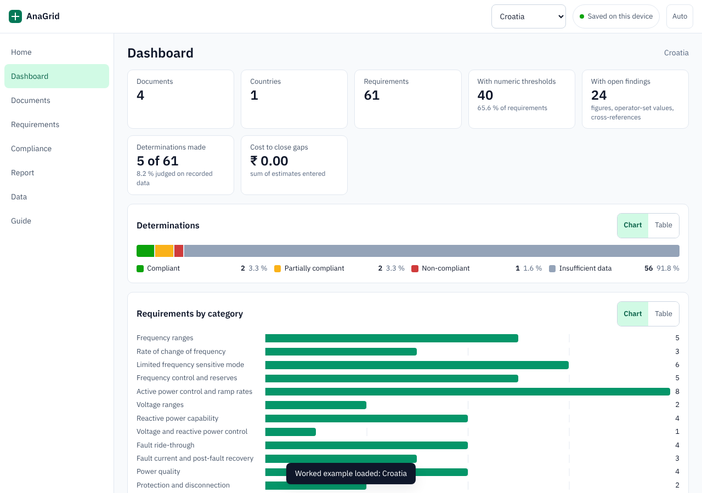

# AnaGrid

Grid code register, requirement extraction and compliance sheet for wind turbine grid connection.

**Live:** https://sathyanarayanan-2001.github.io/anagrid/



AnaGrid keeps the grid connection documents of each country you work in, reads them line by line, and turns them into one requirement sheet in which every requirement cites its document, article, paragraph, page and line. Record what the turbine is proven to do and each requirement is judged as compliant, partially compliant, non-compliant or insufficient data.

## Features

- **Document register** per country: transmission and distribution codes, EU regulation, national parameter decisions, operator data lists, standards. A checklist shows which kinds are still missing for a country.
- **Reads .docx, text-based .pdf and .txt on the device.** No upload, no library: the Word and PDF readers are part of the app.
- **Translation to English inside the browser** (Chrome 138 or later on a desktop), line by line, so line numbers and citations stay valid for the original and the English text.
- **Requirement extraction.** Clauses are split into paragraphs and table rows; obligations and numeric limits are recognised, classified into 22 categories and listed with article, paragraph, page and line. You review the list before anything is saved.
- **Compliance determination from recorded evidence only.** Checks such as `RoCoF withstand >= 2 Hz/s` compare a requirement with a recorded turbine capability. Missing data is always *insufficient data*; a manual *compliant* needs written evidence.
- **Findings** on anything that can block approval: curves that exist only as figures, values the operator sets per project, parameters the source leaves open, obligations without a number, referenced standards, discrepancies between documents.
- **Requirements document** as HTML, Markdown or CSV, or printed.
- **Dashboard** with a Chart and Table view for every figure.
- **Offline first.** Installs as an app, works without a network, light and dark themes, phone layout.
- **Sync through a OneDrive folder** (Chrome or Edge on a computer), JSON backup, CSV import with preview.
- **Worked example:** Croatia, 4 documents and 61 condensed requirements with article and table-row citations.

## Privacy

- Everything stays in your browser (IndexedDB). There are no accounts, no analytics and no network calls for your data. The page's Content-Security-Policy allows it to load only its own files.
- Sync writes compressed save files into a folder you choose; nothing else leaves the device.
- The repository contains no personal data. `.gitignore` blocks save files, backups, exports and office documents, and tests use made-up text and amounts only.
- The worked example restates public regulatory provisions. Its turbine values are invented.

## Getting started

Use the live link, or run it locally:

```bash
npm ci          # Node 22
npm test        # unit tests
npm run build   # writes dist/index.html
npm run serve   # http://127.0.0.1:8080
npm run test:e2e   # browser tests; needs Chrome (set CHROME_PATH if it is not found)
```

In the app: **Add a document**, choose **Extract requirements**, record **turbine capabilities** on the Compliance tab, then open the **Report**. The Guide tab explains each step.

## Limits

- Extraction is rule based and deterministic. It does not interpret figures, formulas or scanned pages, and it reads English wording best.
- PDF text is read by position; check tables against the source. Password-protected and scanned PDFs cannot be read.
- Translation needs desktop Chrome; elsewhere, paste an English text.
- The tool supports an engineering review and does not replace it.

## Documentation

- [Setup and first deployment](docs/SETUP.md)
- [Architecture, data model and complexity](docs/ARCHITECTURE.md)
- [Verification record](docs/VERIFICATION.md)
- [FMEA, DMAIC and root-cause notes](docs/FMEA.md)
- [Changelog](CHANGELOG.md) · [Contributing](CONTRIBUTING.md) · [Security](SECURITY.md)

## Licence

MIT, see [LICENSE](LICENSE). The embedded font IBM Plex Sans is under the SIL Open Font License 1.1, see [licenses/IBM-Plex-Sans-OFL.txt](licenses/IBM-Plex-Sans-OFL.txt).
